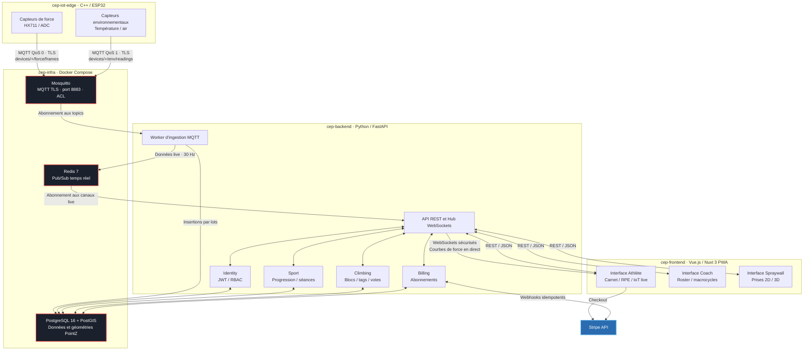

# Centre-EP

Ce dépôt présente l’architecture cible de la plateforme Centre-EP, ainsi que
les repères pour contribuer et tester ses composants. Le schéma ci-dessous
reflète l’architecture décrite dans le projet ; les dépôts applicatifs cités
ne sont pas encore disponibles dans l’organisation consultée.

## Architecture et interactions

La plateforme relie des capteurs installés sur le mur d’escalade à une
application web, en passant par un broker MQTT, une base de données et une API.
Les composants sont séparés par responsabilité :

| Dépôt / composant | Rôle |
| --- | --- |
| `cep-iot-edge` | Logiciel C++ sur ESP32. Il lit les capteurs de force (HX711/ADC) et les capteurs environnementaux (température/qualité de l’air), puis publie leurs mesures en MQTT. |
| `cep-infra` | Infrastructure locale Docker Compose : Mosquitto pour MQTT, PostgreSQL 16 avec PostGIS pour les données et géométries PointZ, et Redis 7 pour la diffusion temps réel. |
| `cep-backend` | Service Python/FastAPI. Un worker ingère les messages MQTT et écrit les mesures en base ; l’API expose REST et WebSockets. Ses domaines métier sont Identity (JWT/RBAC), Sport, Climbing et Billing. |
| `cep-frontend` | Application Vue.js / Nuxt 3 PWA. Elle fournit les interfaces Athlète (carnet, RPE, données IoT en direct), Coach (roster, macrocycles) et Spraywall (sélection de prises 2D/3D). |
| Stripe | Service externe de paiement, utilisé pour le checkout et les webhooks d’abonnement. |

### Parcours des données

1. Les capteurs publient leurs mesures sur Mosquitto via MQTT chiffré par TLS.
   Les topics de force utilisent QoS 0 ; les mesures environnementales utilisent
   QoS 1.
2. Le worker du backend s’abonne aux topics, enregistre les mesures par lots
   dans PostgreSQL et publie les données destinées au direct dans Redis.
3. L’API récupère les événements live depuis Redis et les transmet à l’interface
   Athlète via WebSockets. Les trois interfaces utilisent également l’API REST
   pour leurs opérations métier.
4. Les domaines du backend appliquent les règles métier et lisent/écrivent dans
   PostgreSQL. Billing échange avec Stripe : l’interface lance le checkout et
   le backend traite les webhooks de manière idempotente.

## Contribuer

1. Ouvrez une issue pour décrire le problème ou la proposition et convenir du
   dépôt concerné.
2. Travaillez dans le dépôt du composant concerné, sur une branche dédiée.
   Gardez les changements ciblés et mettez à jour la documentation ou les tests
   du composant lorsqu’ils sont concernés.
3. Avant d’ouvrir une pull request, exécutez les vérifications indiquées par le
   dépôt (tests, lint et build si disponibles) et décrivez les résultats ainsi
   que les étapes de validation manuelle.
4. Dans la pull request, expliquez le besoin, les changements, les impacts sur
   les autres composants et les éventuelles modifications de configuration ou
   de schéma de données. Ne joignez ni secrets, ni certificats, ni données
   personnelles.

Pour une modification qui traverse plusieurs composants, indiquez l’ordre de
déploiement et les contrats concernés (topics MQTT, API REST/WebSocket,
schéma PostgreSQL ou canaux Redis).

## Tester

Il n’existe pas encore de commande de test commune documentée pour l’ensemble
de la plateforme. Les commandes exactes doivent être prises dans le README,
les fichiers de configuration et les workflows CI du dépôt concerné ; ne
supposez pas qu’une commande ou un service est disponible dans tous les dépôts.

Tests à privilégier selon le composant :

- **`cep-iot-edge`** : tests unitaires de lecture et de conversion des capteurs,
  puis vérification sur matériel ou simulateur que les mesures sont publiées
  sur les topics attendus avec le QoS prévu.
- **`cep-infra`** : validation de la configuration Compose et démarrage local
  des services ; vérifier la connectivité, les ACL/TLS MQTT, les migrations
  PostgreSQL/PostGIS et Redis.
- **`cep-backend`** : tests unitaires des domaines et du worker, tests
  d’intégration avec des services de test pour MQTT, PostgreSQL et Redis, puis
  tests de contrat des routes REST, WebSockets et webhooks Stripe.
- **`cep-frontend`** : tests unitaires et de composants, puis tests des parcours
  Athlète, Coach et Spraywall contre une API de test.
- **Parcours de bout en bout** : publier une mesure de test, vérifier son
  ingestion en base, sa diffusion via Redis/WebSocket, et son affichage côté
  Athlète. Tester séparément le checkout et le traitement idempotent d’un
  webhook Stripe en environnement de test.

Les tests d’intégration et de bout en bout doivent utiliser des services et
des comptes de test ; ne publiez pas de mesures réelles, secrets ou données
personnelles dans les logs ou fixtures.
